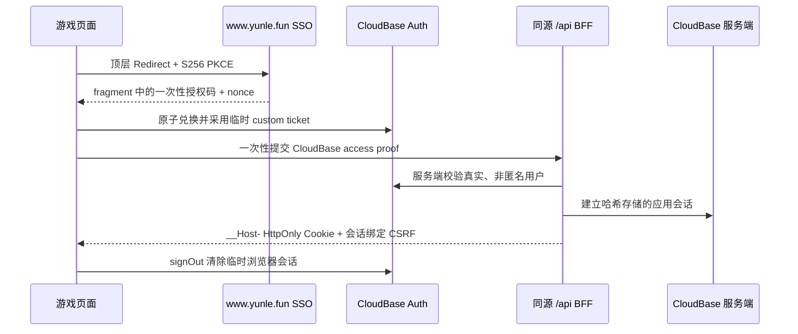

# SSO 0.4 + 同源 BFF

账号接入采用两层职责：`@yunlefun/sso` 只完成一次身份联邦，GZA：暴力电驴 BFF 负责长期、可撤销的应用会话。浏览器不保存主站 session、CloudBase refresh token 或应用会话 token。

## 安全边界

- SSO 使用 `@yunlefun/sso@0.5.x` 的顶层 Redirect、256-bit nonce、显式 `identity:bootstrap` scope 和 S256 PKCE；不使用 popup、隐藏 iframe、native bridge 或 legacy token 传递。
- BFF Cookie 名为 `__Host-dayun-kicker-session`，属性固定为 `Path=/; Secure; HttpOnly; SameSite=Lax`，不设置 `Domain`。
- Cookie 中只有 256-bit opaque token；CloudBase 只保存 SHA-256 会话标识和经过哈希的设备元数据，不保存原始 token、CloudBase access/refresh token 或 CSRF 值。
- 会话空闲期 24 小时、绝对期限 30 天、每 5 分钟最多 touch 一次、24 小时轮换一次；同一用户最多 5 个活动会话，超限撤销最早的会话。
- 所有写请求要求精确 `Origin` 和当前会话派生的 `x-csrf-token`。轮换后旧 Cookie 与旧 CSRF 同时失效。
- `DELETE /api/session` 原子撤销服务端会话并清除 Cookie。过期或撤销的令牌无法继续访问账号、购买、权益、钱包或成绩接口。
- BFF 使用 `account-api.getAccountForUser` 和 `dayun-kicker-api` 的内部 action。显式 `userId` 只有同时携带对应服务端 secret 才会被云函数接受。

## EdgeOne Node Function 环境变量

| 名称 | 必需 | 说明 |
| --- | --- | --- |
| `CLOUDBASE_ENV_ID` | 否 | 默认 `yunlefun-8g7ybcxc7345c490` |
| `CLOUDBASE_ACCESS_KEY` | 是 | EdgeOne 服务端访问 CloudBase 的 API key，不得使用 `VITE_` 前缀 |
| `SESSION_CSRF_SECRET` | 是 | 至少 32 bytes 的独立随机 secret |
| `ACCOUNT_API_INTERNAL_TOKEN` | 是 | 与 `account-api` 相同，至少 32 bytes |
| `DAYUN_KICKER_BFF_TOKEN` | 是 | 与 `dayun-kicker-api` 相同，至少 32 bytes |
| `APP_ORIGIN` | 否 | 默认 `https://dayun-kicker.yunle.fun`，预发必须显式设置为预发 origin |
| `CLOUDBASE_GAME_FUNCTION_NAME` | 否 | 默认 `dayun-kicker-api` |
| `WALLET_URL` | 否 | 默认 `https://www.yunle.fun/wallet`；钱包目标只由服务端决定 |

密钥应分别随机生成，禁止复用 CloudBase Web publishable key。示例：`openssl rand -base64 48`。

## CloudBase 资源

创建 server-only 集合 `ylf_app_sessions`，禁止浏览器读写，并按 [资源清单](https://github.com/YunLeFun/dayun-kicker/blob/main/cloudbase/ylf_app_sessions.manifest.json) 创建四个组合索引。会话适配器在事务内完成创建、上限淘汰、touch、轮换、过期和撤销；终态记录建议保留 90 天后由受控任务清理。

`dayun-kicker-api` 还需增加 `DAYUN_KICKER_BFF_TOKEN`，值与 EdgeOne BFF 相同。`ACCOUNT_API_INTERNAL_TOKEN` 继续与 `account-api` 共享。

## 发布顺序

1. 创建 `ylf_app_sessions`、server-only 权限和索引。
2. 给 CloudBase `dayun-kicker-api` 配置两个内部 token 并部署当前函数版本。
3. 给 EdgeOne Pages 配置服务端环境变量；构建变量仍只用于公开 CloudBase 读取。
4. 确认 SSO provider 白名单包含应用的精确 HTTPS origin。
5. 发布 EdgeOne 版本，验证 Redirect 回跳、BFF Cookie、刷新恢复、轮换、退出撤销、钱包和购买。

资源创建、secret 配置和正式部署会修改外部状态，不由仓库测试自动执行。
